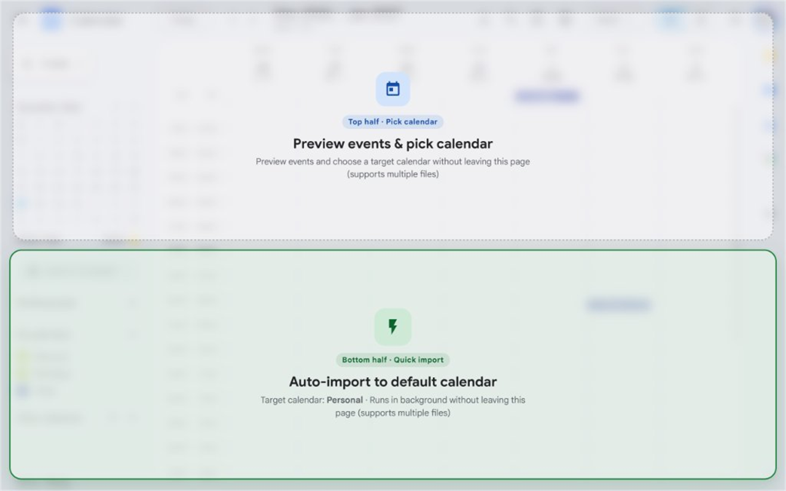
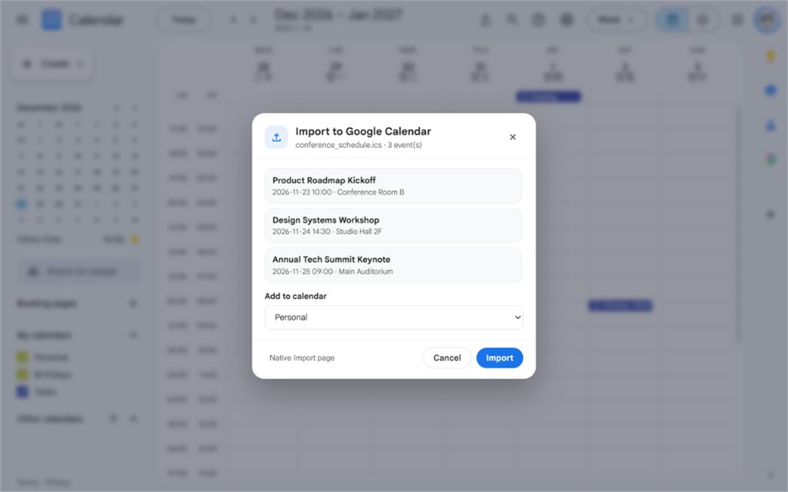
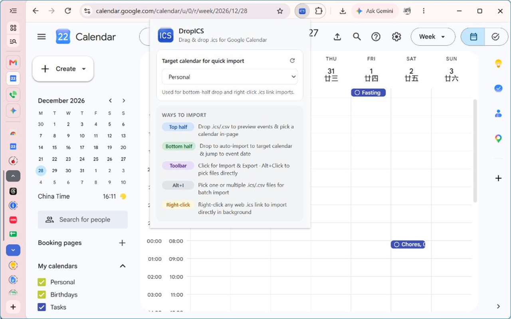
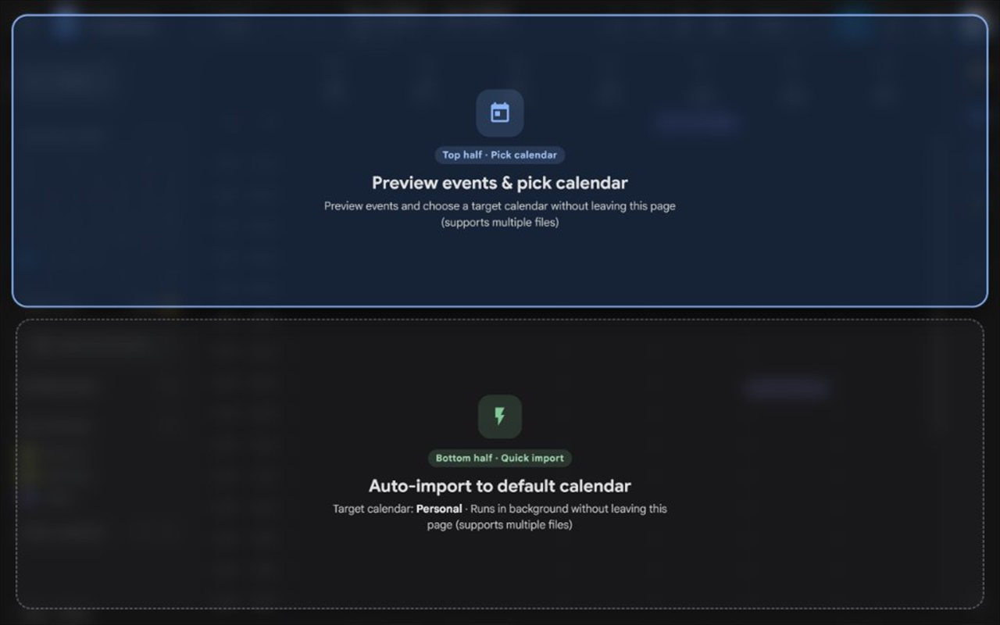

# DropICS - Drag & Drop `.ics` for Google Calendar

[](https://chromewebstore.google.com/detail/dropics-drag-drop-ics-for/momahmadfpmpndnlioonmaopkfkgcild)
[](https://chromewebstore.google.com/detail/dropics-drag-drop-ics-for/momahmadfpmpndnlioonmaopkfkgcild)
[](https://github.com/patpat9/dropics/actions/workflows/ci.yml)
[](LICENSE)


https://github.com/user-attachments/assets/7f4e7cf1-21b7-40d2-b2a4-7f562661476b


A lightweight, zero-OAuth Chrome extension (Manifest V3) that lets you drag and drop `.ics` and `.csv` files directly onto Google Calendar, preview events and pick a target calendar without leaving your schedule, import web `.ics` links via right-click, and jump straight to the imported event date.

**[Install from the Chrome Web Store](https://chromewebstore.google.com/detail/dropics-drag-drop-ics-for/momahmadfpmpndnlioonmaopkfkgcild)**

- **Releases**: [GitHub Releases](https://github.com/patpat9/dropics/releases) (`dropics-v*.zip`)
- **License**: [AGPL-3.0](LICENSE)
- **Privacy**: [PRIVACY.md](PRIVACY.md) · **Contributing**: [CONTRIBUTING.md](CONTRIBUTING.md)

---

## Screenshots

| Split-Screen Drag & Drop Overlay | In-Page Event Preview & Calendar Picker |
| :---: | :---: |
|  |  |

| Toolbar Import Shortcut & Extension Popup | Dark Mode Support |
| :---: | :---: |
|  |  |

---

## Features & Ways to Import

| Method | Action | Behavior |
| :--- | :--- | :--- |
| **Top-half drop** | Drag `.ics` / `.csv` onto the upper half of Google Calendar | Opens an in-page preview modal showing event titles, dates/times, and locations, lets you pick any writable calendar, and imports in the background (supports multiple files). |
| **Bottom-half drop** | Drag `.ics` / `.csv` onto the lower half of Google Calendar | Silently imports into your configured default calendar via a background tab, auto-closes it when finished, and jumps to the earliest imported event's date (with a **Previous date** undo button). |
| **Header button** | Click the **Import** icon next to Search in Google Calendar | `Click` opens `/settings/export`, `Ctrl/Cmd + Click` opens in a new tab, `Alt + Click` opens the multi-file `.ics` / `.csv` picker directly. |
| **Keyboard shortcut** | Press `Alt+I` on Google Calendar | Opens the native multi-file picker to preview and batch-import one or multiple `.ics` / `.csv` files sequentially. |
| **Right-click web link** | Right-click any `.ics` / `.csv` link on any webpage | Click **Import .ics to Google Calendar** to fetch the file using your active tab session and import it in the background. |

### Additional Highlights

- **Zero OAuth / No External Servers**: Uses your existing Google Calendar browser session and native `/settings/export` import flow. No Google API tokens, no third-party servers, and no tracking.
- **Auto-Detected Writable Calendars**: Reads your `My calendars` list and syncs strictly with Google Calendar's `/settings/export` writable calendar dropdown (excluding read-only `Other calendars` and system calendars such as `Birthdays` or `Tasks`). Includes an on-demand sync button (`↻`) in the popup.
- **Theme-Aware Glass Overlay**: Automatically adapts to Google Calendar's Light and Dark themes.
- **Smart Date Jump**: Parses `VEVENT` start dates (ignoring `VTIMEZONE` historical definitions) and navigates directly to the earliest imported event date, with a toast notification and one-click return to your previous view.

---

## Privacy & Permissions

DropICS has no backend server, analytics, or telemetry, and never sends your data to the developer or third parties. See the full [Privacy Policy](PRIVACY.md).

DropICS requests the minimum Manifest V3 permissions required for its features:

| Permission / Host | Purpose |
| :--- | :--- |
| `https://calendar.google.com/*` | Injects the drag-and-drop overlay, preview modal, header Import button, and background import automation on Google Calendar. |
| `storage` | Saves your preferred target calendar (`chrome.storage.sync`) and detected writable calendar list (`chrome.storage.local`), and holds files temporarily during an import (`chrome.storage.session`). |
| `scripting` | Attaches dropped or fetched `.ics` / `.csv` files into Google Calendar's `/settings/export` file input (`world: 'MAIN'`) and syncs writable calendar options. |
| `contextMenus` | Adds the **Import .ics to Google Calendar** right-click menu item on links. |
| `activeTab` | Fetches a right-clicked `.ics` / `.csv` link using the active tab's existing session only when you explicitly trigger the context menu (avoids `<all_urls>`). |

---

## Installation

### Option 1: Chrome Web Store (Recommended)
Install from the [Chrome Web Store listing](https://chromewebstore.google.com/detail/dropics-drag-drop-ics-for/momahmadfpmpndnlioonmaopkfkgcild). Updates are installed automatically.

### Option 2: GitHub Release ZIP
1. Download `dropics-v1.2.0.zip` from [GitHub Releases](https://github.com/patpat9/dropics/releases).
2. Extract the archive to a local folder.
3. Open `chrome://extensions/` in Chrome and enable **Developer mode** (top right).
4. Click **Load unpacked** and select the extracted folder.
5. Refresh any open Google Calendar tab (`https://calendar.google.com`).

### Option 3: From Source
```bash
git clone https://github.com/patpat9/dropics.git
```
Then load the cloned directory via `chrome://extensions/` -> **Developer mode** -> **Load unpacked**, and refresh Google Calendar.

---

## Supported Languages (11 Locales)

All UI strings, popup guides, context menus, and Chrome Web Store metadata are localized in `_locales/`:

`en` (English), `zh_CN` (简体中文), `zh_TW` (繁體中文), `es` (Español), `pt_BR` (Português - Brasil), `ja` (日本語), `de` (Deutsch), `fr` (Français), `ko` (한국어), `ru` (Русский), `it` (Italiano).

---

## Development & Release

### Validation & Tests
Run the built-in validator (checks `manifest.json`, JavaScript syntax across all runtime scripts, all 11 locale files for completeness/unused keys/CWS length limits, and `.ics`/`.csv` date-parsing unit tests):

```bash
node scripts/validate.js
```

CI runs `node scripts/validate.js` automatically on pushes and pull requests to `main` via [`.github/workflows/ci.yml`](.github/workflows/ci.yml).

### Creating a Release
The release workflow ([`.github/workflows/release.yml`](.github/workflows/release.yml)) triggers on `v*` tags and verifies that the tag matches `manifest.json`'s `version`:

```bash
git tag -a v1.2.0 -m "DropICS v1.2.0"
git push origin v1.2.0
```

### Project Structure

```text
dropics/
├── manifest.json            # Extension manifest (MV3)
├── background.js            # Service worker: import jobs, calendar sync, context menu, Alt+I
├── content.js               # Google Calendar UI: toolbar button, split overlay, preview modal, parser
├── styles.css               # Overlay, modal, toast, and toolbar styles (light & dark themes)
├── popup.html / .css / .js  # Toolbar popup: target calendar selector, sync button, quick guide
├── _locales/                # 11 locale translations (messages.json)
├── icons/                   # Extension icons (16, 48, 128 px)
├── scripts/validate.js      # Manifest, syntax, i18n, and parser test suite
├── store_assets/            # Chrome Web Store screenshots, promo tiles, and sample .ics
└── .github/workflows/       # CI validation and tag-triggered GitHub Release packaging
```
